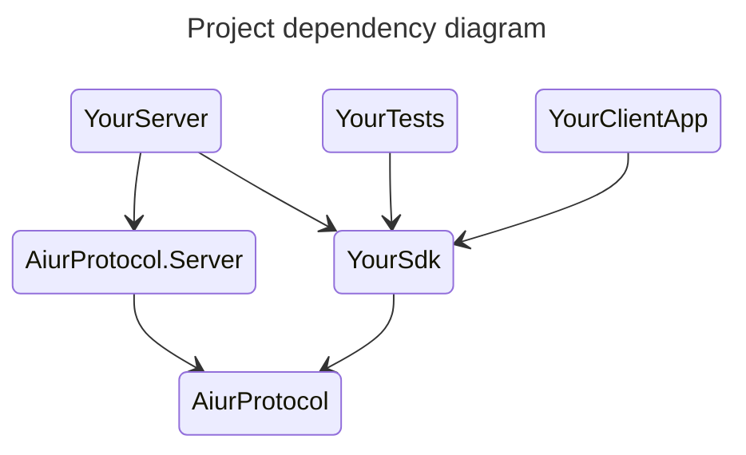

# Aiursoft AiurProtocol

[](https://github.com/AiursoftWeb/aiurprotocol/blob/master/LICENSE)
[](https://gitlab.aiursoft.com/aiursoft/aiurprotocol/-/pipelines)
[](https://gitlab.aiursoft.com/aiursoft/aiurprotocol/-/pipelines)
[](https://s360.aiursoft.com/SupplyChain?tab=projects&project=aiursoft%2Faiurprotocol&scope=baseline&ecosystem=all)
[](https://www.nuget.org/packages/Aiursoft.AiurProtocol/)
[](https://www.nuget.org/packages/Aiursoft.AiurProtocol.Server/)
[](https://manhours.aiursoft.com/r/github.com/aiursoftweb/aiurprotocol.html)

AiurProtocol defines an API programming practice to easily build a RESTful API. It simplifies the process of

* Auto HTTP request path building
* Strong-typed API model sharing
* Auto HTTP status code translation
* Auto error handling\error pass through
* Auto input model validation\local validation
* Auto serialization and deserialization
* Document generation

And the API it built is also standard Restful HTTP API, so you can call it with any programming language.

With AiurProtocol, you can focus on designing your API and forget about those complications!

<a name="aiurprotocol"></a>

## Overview

### What is AiurProtocol?

<a name="why-this-project"></a>

API development is a challenging task that requires handling various aspects such as HTTP status codes, error handling, input validation, documentation writing, and log checking. However, this project aims to simplify the API development process by providing a unified best practice approach. By following this approach, developers can efficiently handle HTTP status codes, error handling, input validation, documentation writing, and log checking. This project's goal is to save time and effort, allowing developers to focus more on developing new features.

## Installation

Add the package to your .NET project:

<a name="how-to-install"></a>

Run the following command to install `Aiursoft.AiurProtocol.Server` to your ASP.NET Core project from [nuget.org](https://www.nuget.org/packages/Aiursoft.AiurProtocol.Server/):

```bash
dotnet add package Aiursoft.AiurProtocol.Server
```

Run the following command to install `Aiursoft.AiurProtocol` to your SDK project which sending requests to your server from [nuget.org](https://www.nuget.org/packages/Aiursoft.AiurProtocol/):

```bash
dotnet add package Aiursoft.AiurProtocol
```

You need to make sure your project dependency is as follows:



So `YourServer` can use `YourSdk` to build the API, and `YourClientApp` can use `YourSdk` to call the API.

`AiurProtocol.Server` helps you building API, and `AiurProtocol` helps you call the API.

Requires .NET 10 or later. `Aiursoft.AiurProtocol.Abstractions` supplies the shared response models and protocol codes; the client and server packages already reference it. Install it directly only when your project needs the shared contracts without an HTTP client or server:

```bash
dotnet add package Aiursoft.AiurProtocol.Abstractions
```

## Usage

Start with a complete ASP.NET Core `Program.cs` after installing the server package:

```csharp
using Aiursoft.AiurProtocol.Models;
using Aiursoft.AiurProtocol.Server;
using Aiursoft.AiurProtocol.Server.Attributes;
using Microsoft.AspNetCore.Mvc;

var builder = WebApplication.CreateBuilder(args);
builder.Services.AddControllers().AddAiurProtocol();

var app = builder.Build();
app.MapControllers();
app.Run();

[ApiExceptionHandler(
    PassthroughRemoteErrors = true,
    PassthroughAiurServerException = true)]
[ApiModelStateChecker]
public class HomeController : ControllerBase
{
    [HttpGet("/api/hello-world")]
    public IActionResult Index()
    {
        return this.Protocol(Code.ResultShown, "Welcome to this API project!");
    }
}
```

Run the server and request `/api/hello-world` to receive the protocol response. The following sections explain server registration and a reusable client SDK.

### Server integration

<a name="how-to-use-on-server"></a>

Register AiurProtocol in your `Startup.cs`

```csharp
// Your startup.cs on server
using Aiursoft.AiurProtocol.Server;

public void ConfigureServices(IServiceCollection services)
{
    services
        .AddControllers()
        .AddAiurProtocol(); // <---- Add this after add controllers!
}
```

Now you can go to your Controller and return the protocol!

```csharp
// Your controller
using Aiursoft.AiurProtocol.Models;
using Aiursoft.AiurProtocol.Server;
using Aiursoft.AiurProtocol.Server.Attributes;
using Microsoft.AspNetCore.Mvc;

[ApiExceptionHandler(
    PassthroughRemoteErrors = true,
    PassthroughAiurServerException = true)]
[ApiModelStateChecker]
public class HomeController : ControllerBase
{
    [Route("/api/hello-world")]
    public IActionResult Index()
    {
        return this.Protocol(Code.ResultShown, "Welcome to this API project!");
    }
}
```

### SDK implementation

<a name="how-to-use-it-to-build-an-sdk"></a>

Now you need to write an SDK for your API.

After creating a new class library project, add the dependencies:

```xml
<!-- Your SDK project file -->
<Project Sdk="Microsoft.NET.Sdk">

    <PropertyGroup>
        <TargetFramework>net10.0</TargetFramework>
        <ImplicitUsings>enable</ImplicitUsings>
        <Nullable>enable</Nullable>
    </PropertyGroup>
    <ItemGroup>
        <PackageReference Include="Aiursoft.AiurProtocol" Version="10.0.34" />
    </ItemGroup>
</Project>
```

Write the following method:

```csharp
// In SDK
using Aiursoft.AiurProtocol;
using Aiursoft.AiurProtocol.Models;
using Aiursoft.AiurProtocol.Services;
using Microsoft.Extensions.DependencyInjection;
using Microsoft.Extensions.Options;

public class DemoServerConfig
{
    public string Instance { get; set; } = string.Empty;
}

public class DemoAccess
{
    private readonly AiurProtocolClient _http;
    private readonly DemoServerConfig _demoServerLocator;

    public DemoAccess(
        AiurProtocolClient http,
        IOptions<DemoServerConfig> demoServerLocator)
    {
        _http = http;
        _demoServerLocator = demoServerLocator.Value;
    }

    public async Task<AiurResponse> IndexAsync()
    {
        var url = new AiurApiEndpoint(host: _demoServerLocator.Instance, route: "/api/hello-world", param: new {});
        var result = await _http.Get<AiurResponse>(url);
        return result;
    }
}

public static class DemoServiceExtensions
{
    public static IServiceCollection AddDemoService(this IServiceCollection services, string endPointUrl)
    {
        services.AddLogging();
        services.AddAiurProtocolClient();
        services.Configure<DemoServerConfig>(options => options.Instance = endPointUrl);
        services.AddScoped<DemoAccess>();
        return services;
    }
}

```

### Client application

<a name="how-to-use-your-new-sdk"></a>

Now you can write a new console app to use your new SDK to call your server!

```csharp
using Microsoft.Extensions.DependencyInjection;

// Set this to the address printed by your running server.
var endpointUrl = "http://localhost:5000";

// To get your SDK:
var services = new ServiceCollection();
services.AddDemoService(endpointUrl);
using var serviceProvider = services.BuildServiceProvider();
using var scope = serviceProvider.CreateScope();
var sdk = scope.ServiceProvider.GetRequiredService<DemoAccess>(); // Or from dependency injection

// To use your SDK:
var result = await sdk.IndexAsync();
Console.WriteLine(result.Message);
```

That's it! It will use your SDK to generate a new call to your server, and the result is right at your hand!

### Advanced usage

* General
  * [HTTP Status code translation](./docs/http_status_code.md)
* API Design samples
  * [Custom routing](./docs/custom_routing.md)
  * [Call with HTTP parameter](./docs/http_get.param.md)
  * [Call with HTTP Post(Json)](./docs/http_post.json.md)
  * [Call with HTTP Post(Form)](./docs/http_post.form.md)
  * [Result paging](./docs/result_paging.md)
* Server Programming features
  * [Response complicated values](./docs/custom_response.md)
  * [Exception handling](./docs/exception_handling.md)
  * [Input valid state checking](./docs/model_validation.md)
* SDK Programming
  * [Exception handling](./docs/exception_handling.md)
  * [Authentication and custom headers](./docs/authentication.md)
  * [Client side input validation](./docs/model_validation.md)

### Future features

It will support the following features in the future:

* API rate limit
* API version control
* API documentation
* API request logging and report

## Configuration

**Server registration**

Call `AddAiurProtocol()` after `AddControllers()`. Apply `ApiModelStateChecker` and `ApiExceptionHandler` to the controllers that use protocol validation and exception translation. The exception handler's `PassthroughRemoteErrors` and `PassthroughAiurServerException` flags both default to `true`; the examples explicitly show those values. Choose their values for your API's error-disclosure policy.

**Client registration and endpoint**

`AddAiurProtocolClient(addHttpClient: true, addMemoryCache: true)` registers a scoped `AiurProtocolClient` and the retry service. Both optional flags default to `true`; disable a flag only when the application provides the corresponding registration itself. A standalone service collection also needs `AddLogging()` for the client's logger.

Configure the server URL in `DemoServerConfig.Instance`, as shown in the SDK example. AiurProtocol does not require its own `appsettings.json`; the consuming SDK decides how to supply its endpoint and authentication. See the [authentication guide](./docs/authentication.md) for request headers and [exception handling](./docs/exception_handling.md) for error propagation.

**Serialization**

`ProtocolSettings.JsonSettings` uses camel-case property names and UTC date/time handling. Server registration applies those shared settings to Newtonsoft.Json.

## Development

Install the [.NET 10 SDK](https://dotnet.microsoft.com/download/dotnet/10.0).

From the repository root, restore, build and test:

```bash
dotnet restore Aiursoft.AiurProtocol.sln
dotnet build Aiursoft.AiurProtocol.sln --no-restore
dotnet test Aiursoft.AiurProtocol.sln --no-restore
```

Run `./lint.sh` for the existing static checks.

## Documentation

- [Advanced usage and API design guides](#advanced-usage)
- [Shared response models](https://github.com/AiursoftWeb/aiurprotocol/tree/master/src/Aiursoft.AiurProtocol.Abstractions/Models)
- [Server integration source](https://github.com/AiursoftWeb/aiurprotocol/tree/master/src/Aiursoft.AiurProtocol.Server)

## How to contribute

There are many ways to contribute to the project: logging bugs, submitting pull requests, reporting issues, and creating suggestions.

Even if you have push rights on the repository, you should create a personal fork and create feature branches there when you need them. This keeps the main repository clean and your workflow cruft out of sight.

We're also interested in your feedback on the future of this project. You can submit a suggestion or feature request through the issue tracker. To make this process more effective, we're asking that these include more information to help define them more clearly.

## License

Licensed under the [MIT License](https://github.com/AiursoftWeb/aiurprotocol/blob/master/LICENSE).
